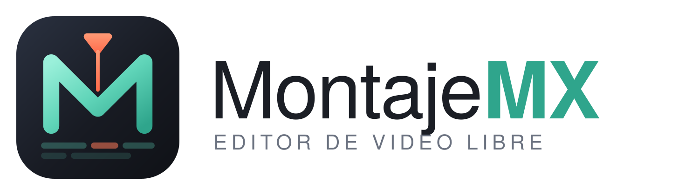

<p align="center"></p>

# MontajeMX

Editor de video multipista libre para **Windows, Linux, macOS y Android**. Sin ediciones de pago, sin marcas de agua y sin límites de uso.
Licencia **GPL-3.0-or-later**. Copyright © 2026 Santiago Miguel.

## Qué hace (v0.3.0)

- **Montaje**: pistas ilimitadas, arrastrar y soltar, recortar, dividir, imán, cerrar huecos, deshacer/rehacer, copiar/pegar, congelar fotograma, velocidad y reversa.
- **Animación**: fotogramas clave de posición, escala, rotación, opacidad y volumen; zoom lento y paneo con un clic.
- **Color**: exposición, contraste, saturación, tono, temperatura, gamma, ruedas de sombras/medios/luces, curva de tonos, color selectivo, 12 looks, LUT `.cube`, histograma.
- **Efectos**: croma, modos de mezcla, máscaras, censura con mosaico, pantalla dividida, imagen en imagen, desenfoque, viñeta, grano, nitidez, reducción de ruido, estabilización, corrección de lente, video 360° a normal y «pequeño planeta».
- **Títulos** con plantillas, borde, sombra, fondo y créditos animados. **Títulos 3D** extruidos con bisel, material, luz y animación.
- **Transiciones**: disolvencia, fundido, deslizar, zoom, barridos y morph.
- **Seguimiento de movimiento**: la máscara sigue a un objeto (mosaico o desenfoque que lo acompaña) y un título o imagen puede seguir el mismo rastro.
- **Multicámara**: hasta 6 tomas sincronizadas por audio, con cambio de ángulo en vivo.
- **DVD con menú**: plantillas, capítulos, carpeta VIDEO_TS e imagen ISO (necesita `dvdauthor` instalado).
- **Audio 5.1**: cada pista se envía a frontal, centro o traseros.
- **Audio**: volumen, fundidos, balance, tono, graves/agudos, reducción de ruido, separar audio y atenuación automática con la voz.
- **Captura**: pantalla, cámara, voz en off y stop motion con papel cebolla.
- **Película rápida**: montaje automático con transiciones, título y música.
- **Exportación**: MP4 (H.264/HEVC), WebM, AV1, MOV ProRes (también con canal alfa), AVI, WMV, M2TS, MPEG-2 para DVD, GIF, secuencias PNG/JPEG y audio (MP3, AAC, WAV, FLAC, AC3), hasta 8K.

Lo pendiente está en [`replica/features.csv`](replica/features.csv).

## Probarla

```bash
npm install
npm start
```

Para empaquetar hay que traer antes FFmpeg para el sistema de destino:

```bash
node scripts/fetch-ffmpeg.js            # sistema actual
node scripts/fetch-ffmpeg.js win32 x64  # u otro: darwin x64 · darwin arm64 · linux x64
```

Requiere Node.js 20 o superior. En desarrollo se usa `ffmpeg-static` o el FFmpeg del sistema; los instaladores llevan el suyo en `resources/bin`.

## Instaladores

```bash
npm run dist:win     # .exe (instalador y portable) — ejecutar en Windows
npm run dist:linux   # .AppImage y .tar.gz
npm run dist:mac     # .dmg — ejecutar en macOS
```

El flujo `.github/workflows/build.yml` compila los tres, más el APK de Android, al publicar una etiqueta `v*` y los adjunta a la *release*.
Los instaladores no van firmados: en macOS hay que abrir la app con clic derecho → Abrir la primera vez; en Windows, SmartScreen pedirá confirmación.

## Android

La versión Android usa la misma interfaz y el mismo motor de render; FFmpeg corre dentro de la app en WebAssembly, sin conexión.
Descarga `MontajeMX-<versión>-android.apk` de la *release*, ábrelo en el teléfono o tableta y permite instalar apps de origen desconocido.

- Pensada para tableta o teléfono en horizontal (Android 7 o superior). Doble toque en un medio lo añade a la línea de tiempo.
- Los medios importados se guardan dentro de la app; las exportaciones, instantáneas y proyectos van a **Documentos/MontajeMX**, y «Mostrar en la carpeta» abre el menú Compartir.
- Exporta MP4 H.264, WebM (VP8), MOV ProRes, AVI, WMV, M2TS, MPEG-2 para DVD, GIF, secuencias y audio. HEVC y AV1 solo en escritorio; el DVD con menú y la grabación de pantalla, también.
- Al no tener varios hilos, exportar es más lento que en la computadora: conviene usar 720p para pruebas rápidas.

Compilar el APK (requiere JDK 21 y Android SDK):

```bash
npm run android:apk        # → android/app/build/outputs/apk/release/app-release.apk
npm run test:android       # prueba el puente en Chromium con FFmpeg WebAssembly
```

Para firmar siempre con la misma llave (y poder actualizar sin desinstalar), añade en GitHub los secretos `ANDROID_KEYSTORE_BASE64` y `ANDROID_KEYSTORE_PASSWORD`; sin ellos el APK se firma con una llave de depuración.

## Pruebas

```bash
npm test         # exporta proyectos sintéticos con FFmpeg real y verifica píxeles, duración y códecs
npm run smoke    # arranca la app, monta un proyecto, reproduce y exporta
```

## Cómo está hecha

| archivo | función |
| --- | --- |
| `src/core/model.js` | modelo del proyecto y matemáticas compartidas (fotogramas clave, color, croma, máscaras) |
| `src/core/render.js` | convierte el proyecto en un grafo de filtros de FFmpeg |
| `src/main.js` | proceso principal: archivos, FFmpeg, proxies, exportación, grabaciones |
| `src/ui/` | interfaz: biblioteca, visor en tiempo real, inspector y línea de tiempo |
| `src/android/` | puente para Android: sustituye al proceso principal (almacén en IndexedDB, FFmpeg WebAssembly en un worker) |
| `android/` | proyecto Capacitor que empaqueta la interfaz como APK |

La vista previa y la exportación usan las mismas fórmulas; el color pasa por una misma LUT 3D en ambos lados. Los efectos que solo se aplican al exportar se revisan con **Fotograma exacto**.

Proyecto independiente, escrito desde cero. No está afiliado a ningún editor comercial ni usa su código, recursos o marca.
